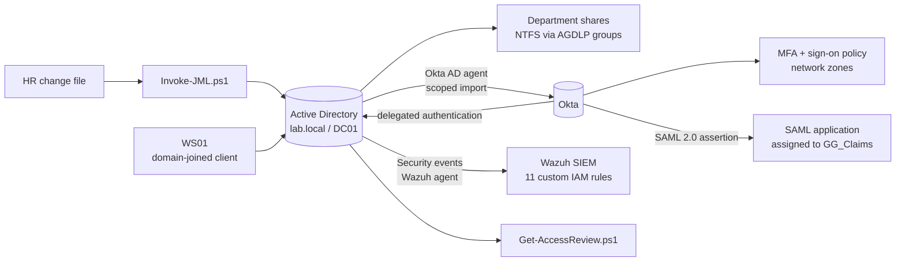

# Hybrid Identity & Access Management Lab

A home lab that runs the day-to-day work of an enterprise IAM team: role-based access in Active Directory, automated joiner/mover/leaver provisioning, privileged access controls, hybrid cloud identity with Okta (AD sync, delegated authentication, MFA, sign-on policy and SAML 2.0 single sign-on), identity threat detection in Wazuh, and documented troubleshooting of real identity faults.

Everything here was built and tested by hand. The [build log](docs/BUILD-LOG.md) records each step with screenshots, including the problems found along the way.

## Architecture



| Host | Role | Address |
|---|---|---|
| DC01 | Windows Server 2022 domain controller, DNS, file shares, Okta AD agent, Wazuh agent | 192.168.50.10 |
| WS01 | Windows 10 Pro domain-joined client | 192.168.50.20 |
| WAZUH01 | Wazuh 4.14.8 appliance (manager, indexer, dashboard) | 192.168.50.30 |
| Okta | Integrator Free Plan org | cloud |

## What it covers

| Area | Implementation | Evidence |
|---|---|---|
| Role-based access | Department OUs, AGDLP group nesting, NTFS permissions granted only through groups | Phase 1 |
| Identity lifecycle | PowerShell JML automation from an HR change file, matched on employee ID, with dry-run mode and full logging | Phase 2 |
| Mover risk | Demonstrated that removed access persists in an open session until re-authentication | TKT-002 |
| Password and lockout policy | 12-character minimum, lockout after 5 failures; stricter fine-grained policy for admins | Phase 3 |
| Privileged access | Separate `adm-` account, non-delegatable; service desk delegated reset and unlock rights only, verified allowed and denied | Phase 3 |
| Hybrid identity | Okta AD agent with OU-scoped import, delegated authentication against AD, mandatory MFA | Phase 4 |
| Sign-on policy | Network-zone-based block for a privileged group, diagnosed through the Okta System Log | TKT-005 |
| Single sign-on | SAML 2.0 app assigned by AD group, with its own authentication policy; unassigned user denied | Phase 4, TKT-007 |
| Detection | 11 Wazuh rules: lifecycle, failed authentication, lockout, brute-force correlation, privileged and out-of-hours group changes (MITRE T1110, T1098), all verified firing | Phase 5 |
| Governance | Access review for stale accounts, non-expiring passwords, privileged membership, incomplete leavers and privilege creep | TKT-006 |

## Troubleshooting tickets

Each ticket records the symptom, the investigation with real output, the root cause, the fix and prevention.

| Ticket | Issue | Root cause |
|---|---|---|
| [TKT-001](tickets/TKT-001-account-lockout.md) | Account keeps locking out | Stale credential retrying from one workstation, traced through event 4740 |
| [TKT-002](tickets/TKT-002-group-added-no-access.md) | Group changed but access did not follow | Access token built at logon; open session kept old groups |
| [TKT-003](tickets/TKT-003-password-expired.md) | Correct password refused | Expired password, reported with the same error as a wrong one |
| [TKT-004](tickets/TKT-004-user-not-syncing.md) | New starter missing from Okta | Account created by hand outside the synced OU, bypassing JML |
| [TKT-005](tickets/TKT-005-mfa-blocked-signin.md) | Service desk analyst cannot sign in | Network-zone policy, then an AD agent timeout reported as "invalid credentials" |
| [TKT-006](tickets/TKT-006-access-review-findings.md) | Access review findings | Planted issues plus one real unplanted finding |
| [TKT-007](tickets/TKT-007-saml-app-access-denied.md) | Assigned user cannot open a SAML app | App policy required FastPass; user enrolled with Okta Verify codes |

## Repository layout

```
iam-hybrid-identity-lab/
├── README.md
├── docs/
│   ├── BUILD-LOG.md          what was built, in order, with findings
│   ├── SETUP.md              step-by-step build guide
│   └── screenshots/          evidence referenced by the log and tickets
├── scripts/
│   ├── Setup-LabStructure.ps1   OUs, AGDLP groups, shares and NTFS
│   ├── Invoke-JML.ps1           joiner / mover / leaver automation
│   ├── Get-AccessReview.ps1     access review reports
│   └── Find-LockoutSource.ps1   traces the machine causing a lockout
├── data/
│   └── hr_changes.csv        sample HR change file
├── wazuh/
│   └── iam_rules.xml         custom detection rules (100100-100122)
├── tickets/                  troubleshooting write-ups
├── logs/                     JML run logs (gitignored)
└── reports/                  access review output (gitignored)
```

## Design decisions

- **Users are matched on `employeeID`, not name**, so two staff with the same name cannot be confused.
- **Movers lose every department group, not just the one HR lists**, removing access left over from earlier moves.
- **Leavers are disabled, not deleted.** Prior groups are recorded in the log and account description for audit, and the account moves out of the cloud sync scope automatically.
- **AD is the source of truth.** Okta reads from AD; Okta-to-AD writeback is disabled.
- **Only `OU=Users,OU=Lab` syncs to the cloud.** Admin, service, built-in and disabled accounts never leave AD.
- **The SIEM runs on its own host**, so logs survive a compromise of the DC.
- **Admins use separate accounts** marked sensitive and non-delegatable, under a stricter password policy.

## Lab only

Temporary passwords from the JML script are written to a local CSV so first logon can be tested; in production they would go through a secure channel. All people and names are fictional.
