# Build Log

A running record of how the lab was built, the decisions made, and the identity-related problems found along the way.

## Environment

| Item | Detail |
|---|---|
| Host | ASUS Zenbook 14, Intel Core Ultra 9 285H, 32 GB RAM, NVMe SSD, Windows 11 |
| Hypervisor | Oracle VirtualBox |
| Lab network | VirtualBox NAT Network `IAMLab`, 192.168.50.0/24, DHCP disabled |

| VM | OS | vCPU / RAM / Disk | IP |
|---|---|---|---|
| DC01 | Windows Server 2022 Standard Evaluation (Desktop Experience) | 2 / 4 GB / 60 GB | 192.168.50.10 (static) |
| WS01 | Windows 10 Pro 22H2 | 2 / 4 GB / 64 GB | Assigned at domain join |
| Wazuh | Official Wazuh OVA (planned, Phase 5) | per OVA | 192.168.50.30 (planned) |

---

## Phase 1: Domain and directory structure

**Network**
- Created NAT Network `IAMLab` (192.168.50.0/24) with DHCP disabled, so that the DC controls addressing and clients are not handed the wrong DNS server.
- Attached DC01 and WS01 to `IAMLab`.

**DC01**
- Installed Windows Server 2022 Desktop Experience.
- Configured the static IP 192.168.50.10/24, gateway 192.168.50.1, DNS 127.0.0.1 (pointing at itself ahead of becoming the DNS server).
- Set the time zone to GMT Standard Time and renamed the host to DC01.
- Verified: `ipconfig /all` correct, gateway reachable, internet reachable (`ping 8.8.8.8`).
- Snapshot `Clean OS` taken before promotion.
- Installed AD DS and promoted DC01 to the first DC of a new forest `lab.local` (NetBIOS `LAB`) with integrated DNS.

- Added DNS forwarders (8.8.8.8, 1.1.1.1) so the DC resolves internet names for the whole lab.
- Snapshot `Domain created`.

**Directory structure**
- Created the OU tree: `Lab` containing `Users` (with department OUs IT, HR, Finance, Claims), `Groups`, `Admins`, `Service Accounts`, `Disabled Users` and `Workstations`.

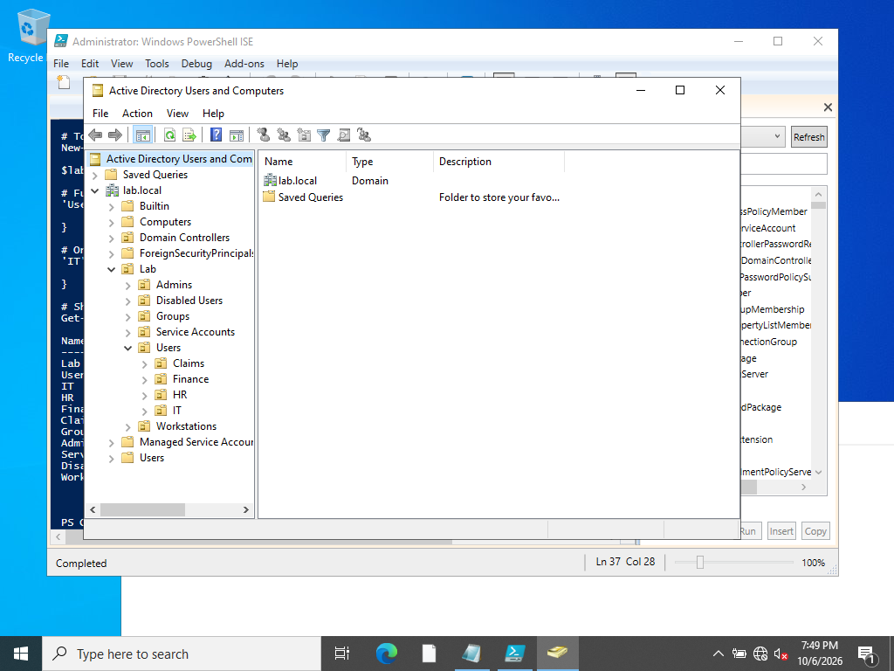

- Created 13 security groups following AGDLP: one global group per department (`GG_<Dept>`), two domain local groups per department share (`DL_Share_<Dept>_RW` and `_RO`), and `GG_IT_ServiceDesk_Admins` for delegated helpdesk rights. Each `GG_<Dept>` is nested in its own `DL_Share_<Dept>_RW`.

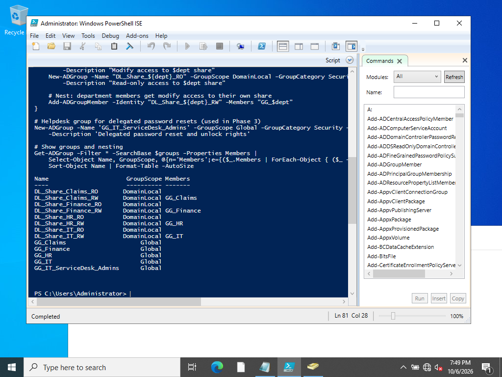

- Created hidden department shares (`IT$`, `HR$`, `Finance$`, `Claims$`) under `C:\Shares`. Share permissions are broad (Authenticated Users: Change); access is controlled by NTFS, with inheritance removed and rights granted only to Administrators, SYSTEM and the department's domain local groups. No user accounts appear in any ACL.

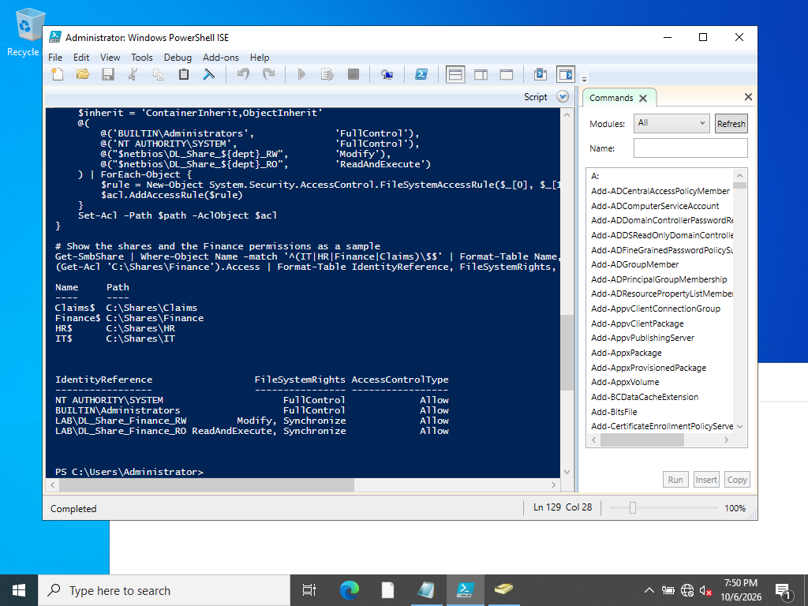

- Snapshot `Structure built`.

**WS01**
- Installed Windows 10 Pro with a local account (`labadmin`) as the domain did not exist yet. This account remains as the local fallback admin after the domain join.
- Configured static IP 192.168.50.20 with DNS pointing at DC01 (192.168.50.10), not the gateway, since clients locate the domain through the DC's DNS.
- Set the time zone to GMT Standard Time to match DC01.
- Verified `lab.local` and `dc01.lab.local` resolve to 192.168.50.10.
- Joined `lab.local`, renamed to WS01 and placed directly in `OU=Workstations,OU=Lab` in one step with `Add-Computer -OUPath`.
- Verified: signed in as `LAB\Administrator`, machine domain reports `lab.local`, and the clock matches the host.

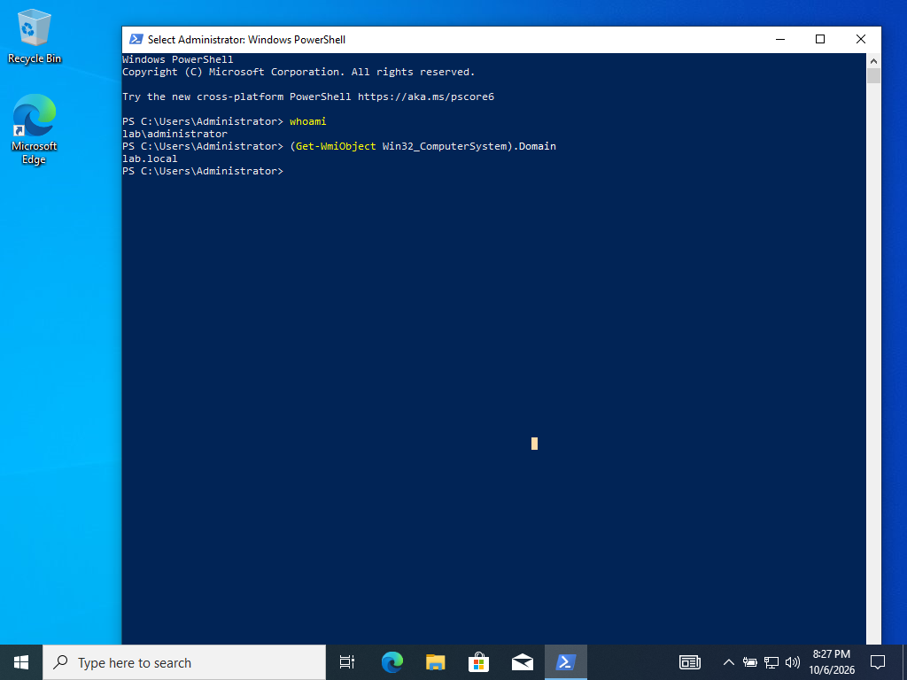

- Verified from DC01 that the computer object sits in `OU=Workstations,OU=Lab`, not the default `CN=Computers` container, so workstation policies can be applied to it.

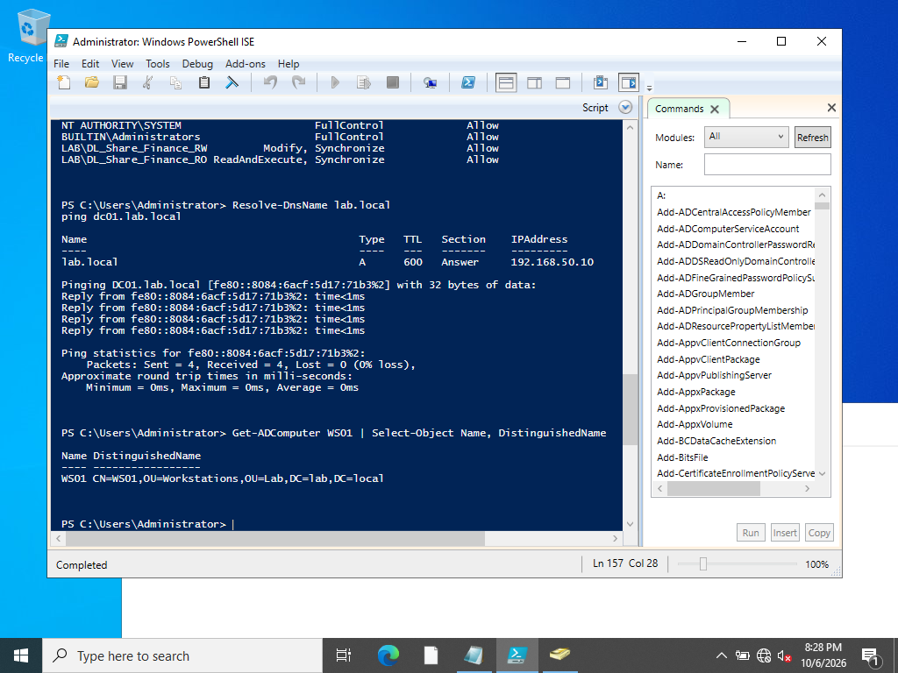

### Design decisions

| Decision | Reason |
|---|---|
| SIEM on a separate VM, not on the DC | Wazuh server components are Linux only, and logs must survive a DC compromise |
| Fresh Wazuh appliance instead of reusing the existing Wazuh lab | Clean evidence for this project, current version, single network, existing lab left untouched |
| Windows 10 Pro as the client | Pro edition supports domain join; the client OS version does not affect the IAM objectives |
| Local admin account kept on WS01 | Fallback access if the PC cannot reach the DC; candidate for Windows LAPS later |

### Issues and resolutions

**Issue 1: VM clocks eight hours behind the host**
- Cause: new installs defaulted to the Pacific time zone.
- Why it matters: Kerberos rejects authentication when clocks differ by more than 5 minutes, so skew between domain members causes logon failures.
- Resolution: set both DC01 and WS01 to GMT Standard Time before the domain join.

**Issue 2: Domain name lookup timed out on WS01 before the join**
- Symptom: `Resolve-DnsName lab.local` timed out immediately after the static IP was configured.
- Cause: the new address was still in the `Tentative` state (duplicate address detection), so the client could not yet send DNS queries.
- Resolution: retried after ~30 seconds; `lab.local` resolved to 192.168.50.10. Lesson: confirm DNS resolution of the domain before attempting a join, since a failed lookup is the most common cause of join errors.

---

---

## Phase 2: Joiner / Mover / Leaver

**Setup**
- Copied `Invoke-JML.ps1` and the HR change file `hr_changes.csv` (5 joiners, 1 mover, 1 leaver) to `C:\IAMLab` on DC01.
- Fixed a defect found before first use: under `-WhatIf` the script's own log and summary writes were also suppressed, so dry runs left no record. Log and report writes now ignore `-WhatIf`, and dry-run entries are tagged `[DRY RUN]`.

**Dry run**
- Ran the full change file with `-WhatIf`. All 5 joiners reported as would-succeed. The mover and leaver failed with "No account with employeeID", which is correct: the joiners did not exist yet, and the script refuses to act on accounts it cannot match by employee ID rather than guessing by name.

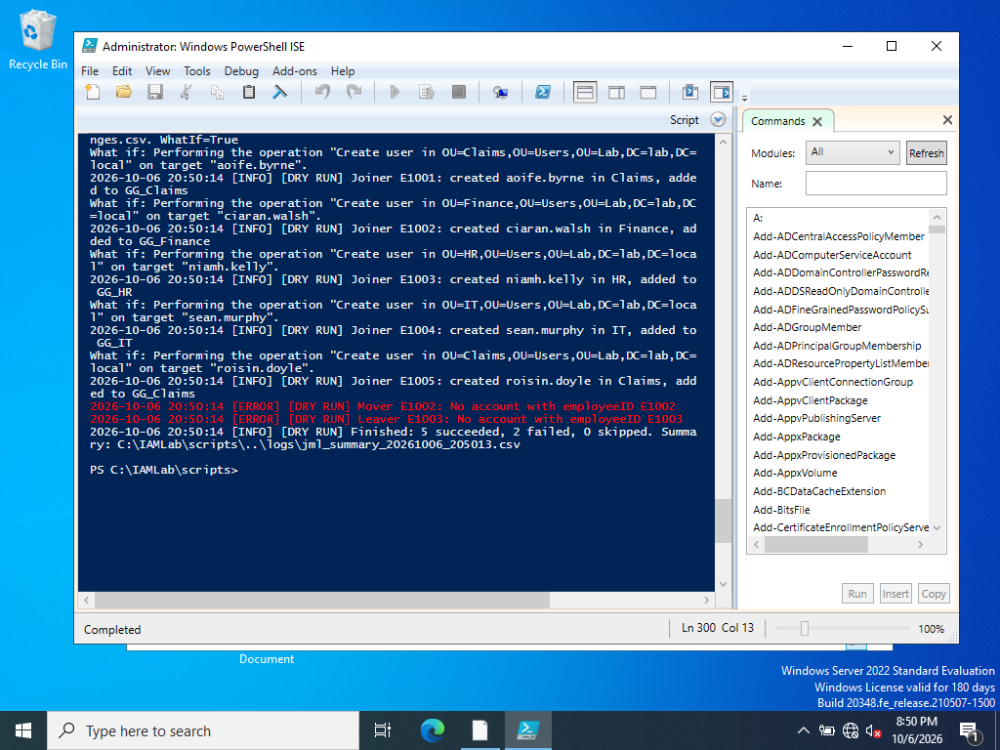

**Joiners**
- Split the change file into two batches so access could be tested before and after the mover and leaver changes.
- Batch 1 created 5 accounts, each in its department OU and department global group, with a random 16-character temporary password and "must change password at next logon" set.

**Joiner verification (WS01)**
- First logon as `ciaran.walsh` forced a password change. The first new password attempted was rejected by the domain password policy (complexity rules, no parts of the user's name), confirming the policy is enforced at the point of change.

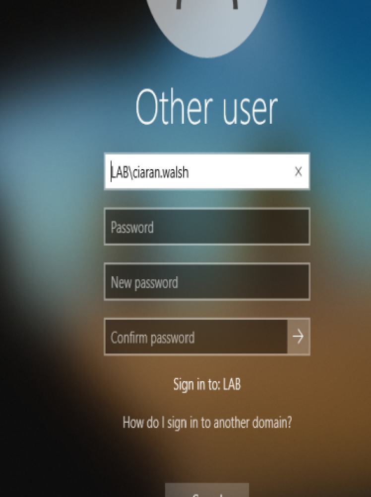

- Ciaran's token contained `GG_Finance` and, through nesting, `DL_Share_Finance_RW`. He could create a file in `\\DC01\Finance$` and was denied `\\DC01\Claims$`.

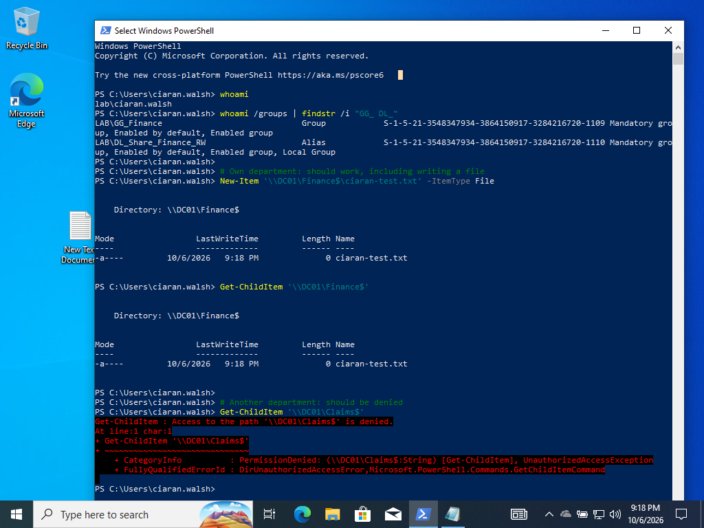

**Mover and leaver**
- Batch 2 moved Ciaran from Finance to Claims (all department groups removed, `GG_Claims` added, department attribute updated, account moved to the Claims OU) and processed Niamh as a leaver (prior groups recorded in the log and account description, all groups removed, account disabled, moved to Disabled Users).

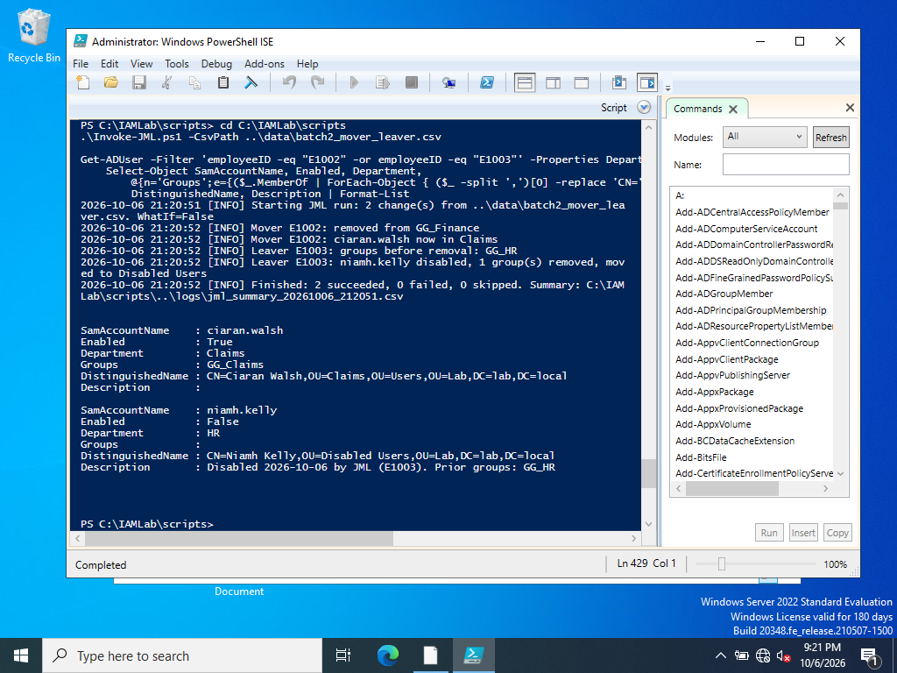

**Mover and leaver verification (WS01)**
- After a fresh logon, Ciaran's token contained `GG_Claims` and `DL_Share_Claims_RW`; Claims opened and Finance was denied.

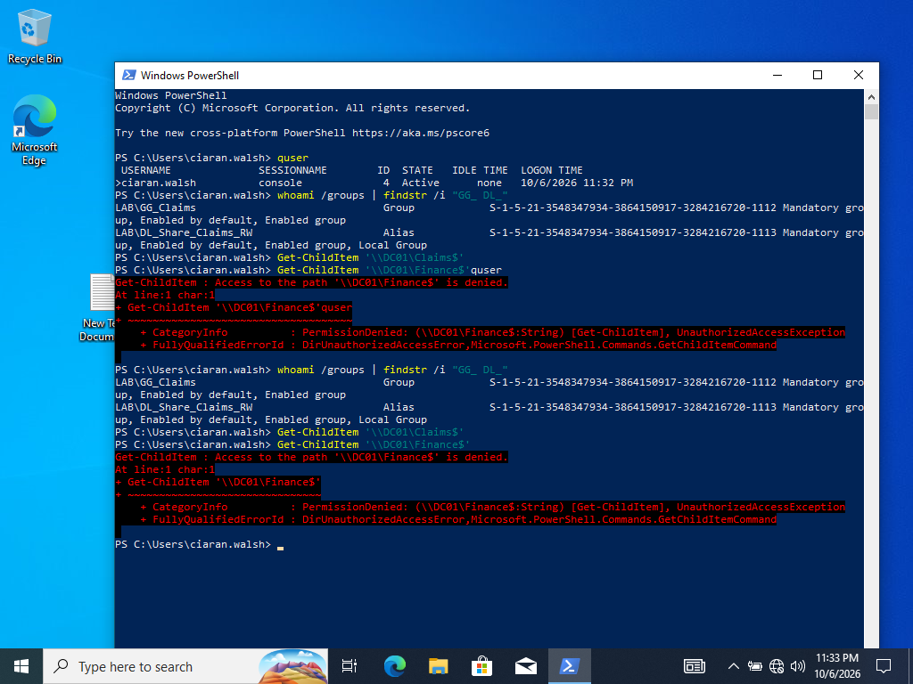

- Logon as `niamh.kelly` was refused: "Your account has been disabled."

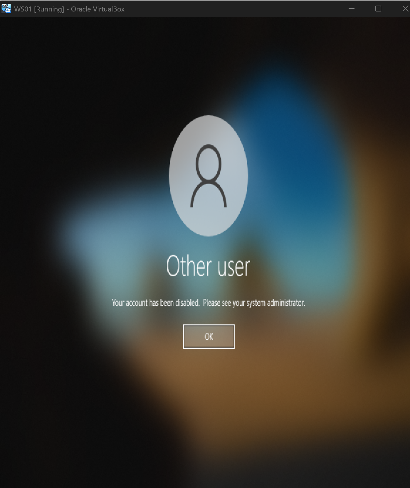

### Findings

**Finding 1: A mover keeps their old access until they re-authenticate**
- Immediately after the mover change was applied in AD, Ciaran's existing WS01 session was retested without logging off:
  ```
  PS C:\Users\ciaran.walsh> whoami /groups | findstr /i "GG_ DL_"
  LAB\GG_Finance            Group   ...
  LAB\DL_Share_Finance_RW   Alias   ...
  PS C:\Users\ciaran.walsh> Get-ChildItem '\\DC01\Finance$'
  ciaran-test.txt
  PS C:\Users\ciaran.walsh> Get-ChildItem '\\DC01\Claims$'
  Get-ChildItem : Access to the path '\\DC01\Claims$' is denied.
  ```
- Cause: group memberships are read into the access token at logon, and the open SMB session to DC01 continued on that token. AD changes do not alter an existing session.
- Risk: a mover, or a leaver who is still signed in, retains previous access until logoff, session loss or Kerberos ticket expiry (default 10 hours).
- Control: leaver and urgent mover processes should force sign-out and revoke active sessions, not only change group membership or disable the account.

**Finding 2: First logon after an unclean DC shutdown carried pre-change group membership (observed, cause not confirmed)**
- DC01 stopped unexpectedly at about 22:40 and was restarted.
- A new logon by Ciaran at 22:52 produced a token still showing `GG_Finance`, although share access (checked at 22:56) behaved according to the new `GG_Claims` membership.
- Investigation:
  - `$env:LOGONSERVER` was `\\DC01` and the session's logon type was 2 (Interactive), not 11 (CachedInteractive), ruling out a cached logon.
  - `klist` showed the primary TGT issued by DC01 at 22:52:37 and a separate `cifs/DC01` ticket issued at 22:56:16.
  - On DC01, Ciaran's account `whenChanged` was 21:20:52 (the mover run) and his only group was `GG_Claims`, ruling out a rollback of the change.
  - A fresh logon at 23:32 produced the correct token (`GG_Claims`, `DL_Share_Claims_RW`).
- Likely cause: the 22:52 logon was serviced while DC01 was still completing recovery after the unclean shutdown. This was not proven; recorded as observed.

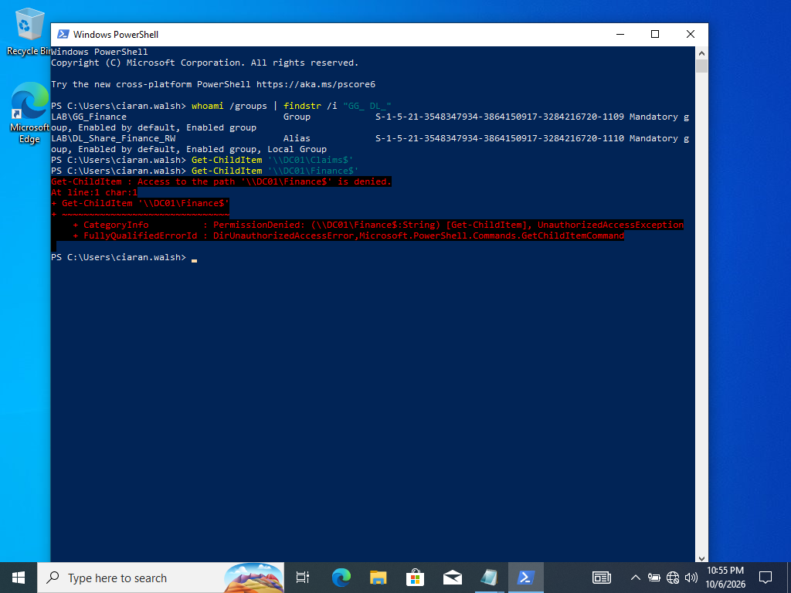

- Lesson: after a DC outage, verify a sample of recently changed accounts with a fresh logon before treating access changes as effective.

**Finding 3: First domain logon on WS01 failed with "domain isn't available"**
- Ciaran's first logon attempt failed although WS01 had a healthy trust (`Test-ComputerSecureChannel` true) and could locate DC01 (`nltest /dsgetdc:lab.local`).
- Likely cause: the logon was attempted before WS01's network was ready after sign-out. A retry a few minutes later succeeded.

---

## Phase 3: Policy and privileged access

**Domain password and lockout policy**
- Replaced the default policy (7-character minimum, no account lockout) with: minimum length 12, complexity on, history 24, minimum age 1 day, maximum age 90 days, lockout after 5 failed attempts for 15 minutes.

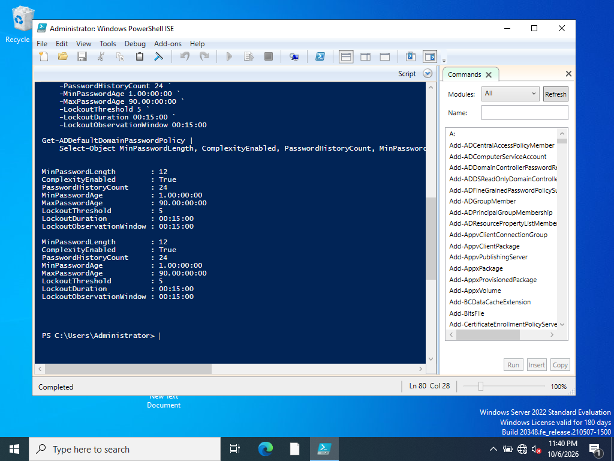

**Separate admin account**
- Created `adm-ish` in `OU=Admins`, a member of `Domain Admins` and `GG_Tier0_Admins`, with "Account is sensitive and cannot be delegated" set so other services cannot act on its behalf with its credentials. Daily work stays on a standard account.

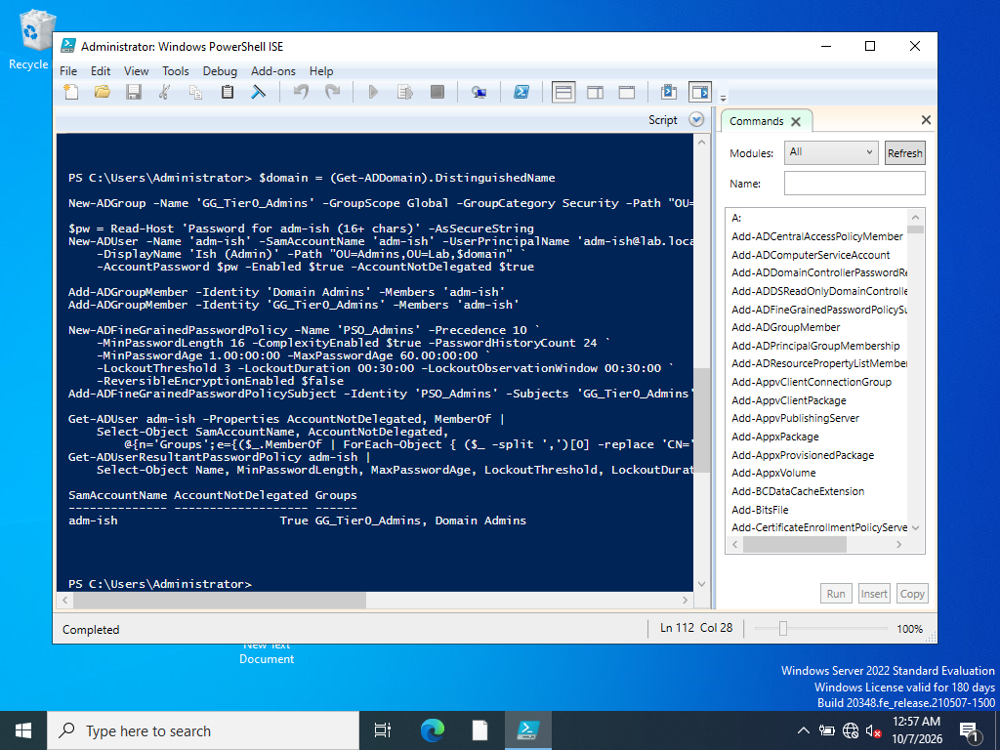

- Created fine-grained password policy `PSO_Admins` (minimum 16 characters, maximum age 60 days, lockout after 3 attempts for 30 minutes) applied to `GG_Tier0_Admins`. Verified with `Get-ADUserResultantPasswordPolicy adm-ish`, which returns `PSO_Admins` rather than the domain policy.

**Delegated service desk rights**
- Granted `GG_IT_ServiceDesk_Admins` three rights on user objects under `OU=Users,OU=Lab` only: Reset Password, write `pwdLastSet` (force change at next logon) and write `lockoutTime` (unlock). Added `sean.murphy` to the group.
- Tested as Sean:

| Action | Result |
|---|---|
| Reset `aoife.byrne`'s password | Allowed |
| Force `aoife.byrne` to change password at next logon | Allowed |
| Add `aoife.byrne` to `GG_Finance` | Denied: insufficient access rights |
| Reset `adm-ish`'s password | Denied: access is denied |

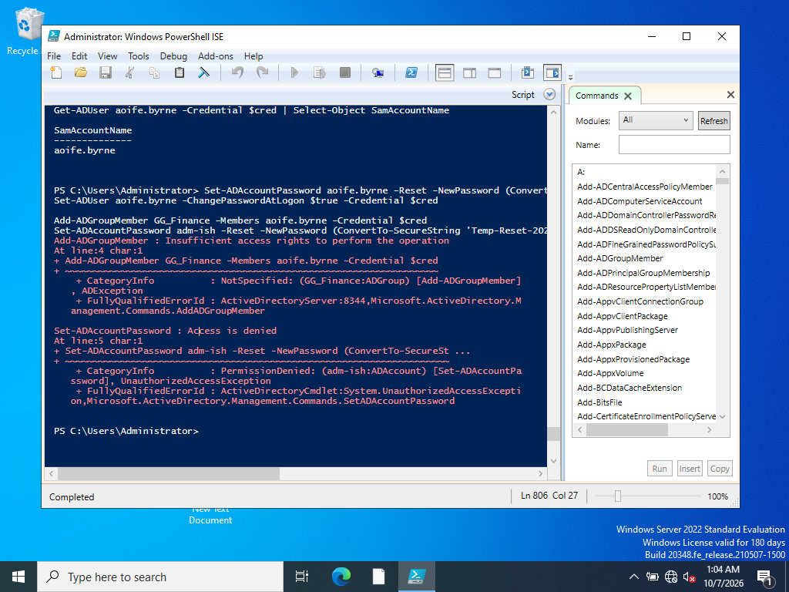

**Audit policy**
- Enabled success and failure auditing on DC01 for Credential Validation, Kerberos Authentication Service, Kerberos Service Ticket Operations, User Account Management, Security Group Management, Logon and Account Lockout.
- Confirmed the Security log holds the full lifecycle of the lab so far: account creation (4720), password resets including the helpdesk reset (4724), group additions and removals from the mover (4728, 4729), the leaver disable (4725) and the lockout (4740).

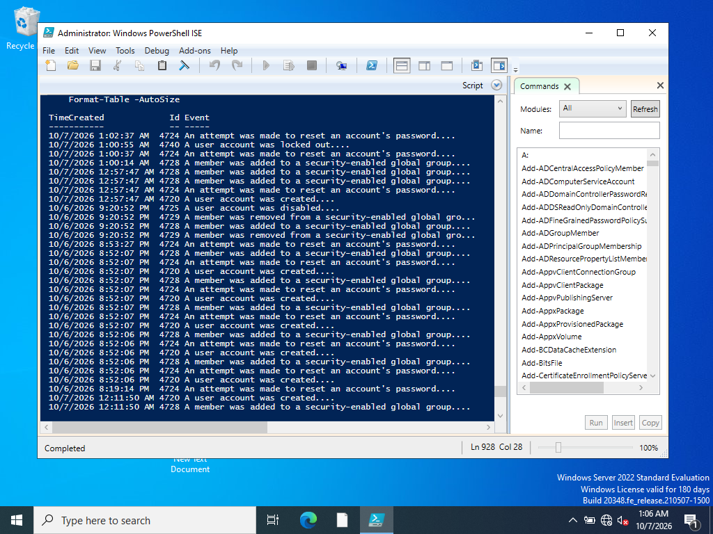

### Findings

**Finding 4: The new lockout policy triggered during its first test**
- While testing the delegation, Sean's password was entered incorrectly in the `Get-Credential` prompt. Each of the following commands attempted authentication with it, and after 5 failures the account was locked: `LockedOut: True`, `badPwdCount: 5`, and event 4740 on DC01.
- The account was unlocked, and the credential was supplied directly instead of through the prompt.
- Lesson: scripted or service tools that retry with a stale credential lock accounts quickly. This is the most common real cause of repeated lockouts (see TKT-001).

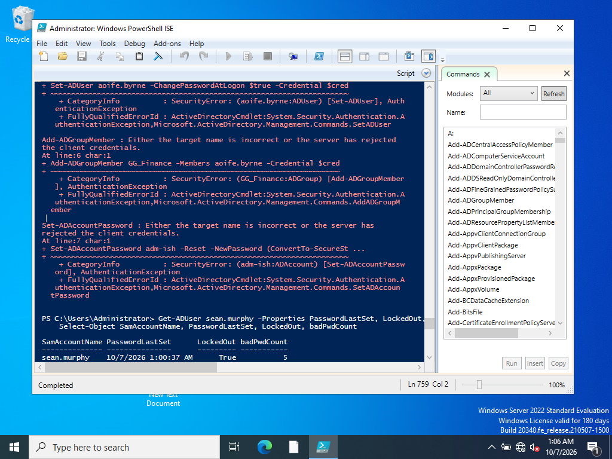

---

## Phase 6 (part 1): Access review

- Added a `-NewAccountGraceDays` parameter to `Get-AccessReview.ps1`; the 14-day grace period for never-used accounts was hard-coded, which hid every account in a lab built the same day.
- Planted four common problems (a password-never-expires exemption, a standard user in Backup Operators, privilege creep into another department's group, a leaver disabled by hand outside JML), ran the review, remediated every finding and re-ran it until all checks returned 0.
- The review also surfaced one issue that was not planted: the built-in Administrator account's password was set never to expire.
- Full write-up: [TKT-006](../tickets/TKT-006-access-review-findings.md).

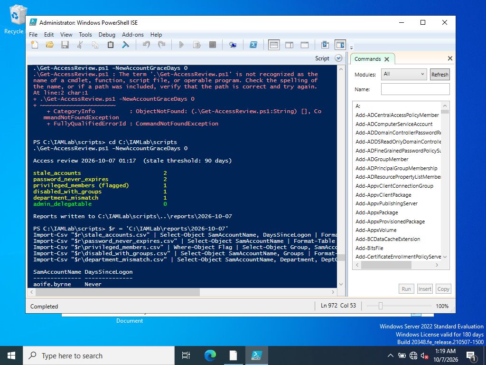

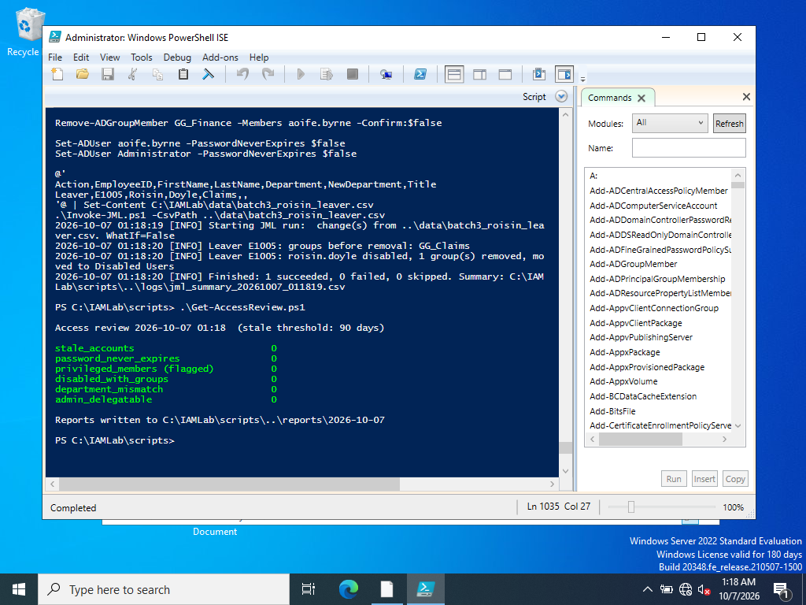

### Findings

**Finding 5: JML log showed a blank change count for a single-row file**
- Processing Roisin's one-line leaver file logged `Starting JML run:  change(s)` with no number.
- Cause: in Windows PowerShell 5.1, `Import-Csv` returns a single object (not an array) for a one-row file, and that object has no usable `Count`.
- Fix: wrapped the import as `@(Import-Csv ...)` so it is always an array. Processing was unaffected; only the log line was wrong.

### Troubleshooting tickets

| Ticket | Issue | How it arose | Key evidence |
|---|---|---|---|
| [TKT-001](../tickets/TKT-001-account-lockout.md) | Account keeps locking out | Simulated: repeated connections from WS01 with an old password | Event 4740 caller computer WS01; five `0x18` Kerberos failures from 192.168.50.20; unlock by `sean.murphy` recorded as event 4767 |
| [TKT-002](../tickets/TKT-002-group-added-no-access.md) | Group membership changed but access did not follow | Arose live during the Phase 2 mover test | Session token held `GG_Finance` after AD showed `GG_Claims`; corrected by a fresh logon |
| [TKT-003](../tickets/TKT-003-password-expired.md) | Correct password refused | Arose from the earlier service desk reset ("must change at next logon") | Generic "rejected the client credentials" error; account showed `PasswordExpired: True` |
| [TKT-006](../tickets/TKT-006-access-review-findings.md) | Access review findings | Planted problems plus one unplanted finding | Review before and after remediation |

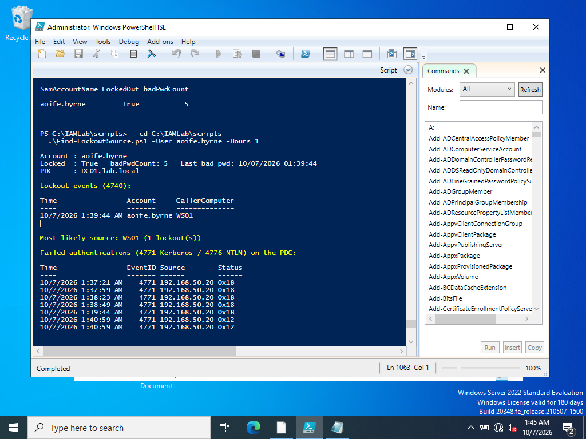

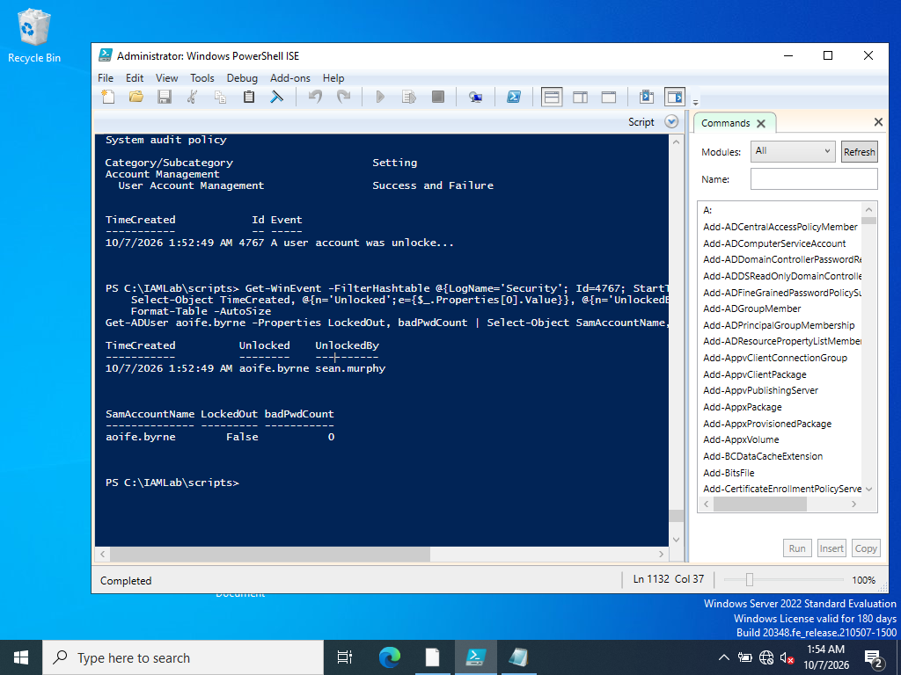

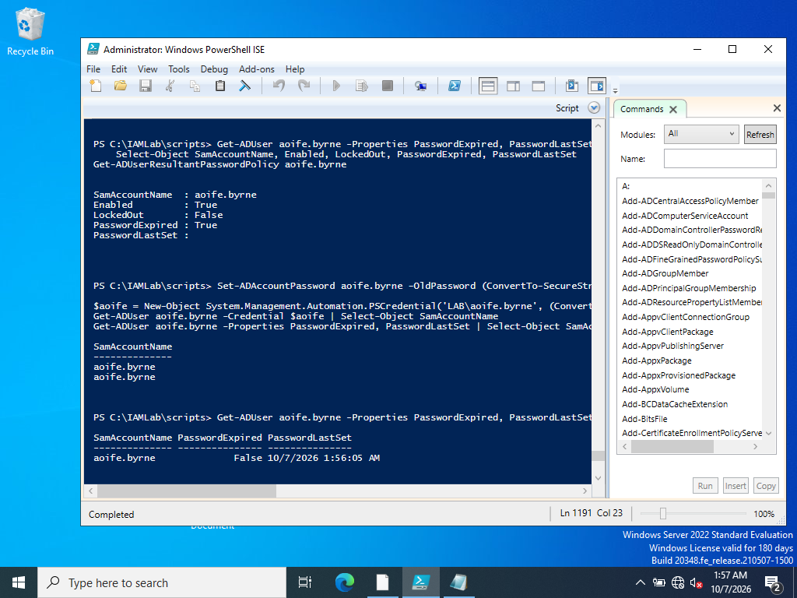

### Findings

**Finding 6: An expired password produces the same error as a wrong one**
- Authenticating with Aoife's correct but expired password returned "the server has rejected the client credentials", identical to a bad password.
- Lesson: the service desk should check the account state (Enabled, LockedOut, PasswordExpired) before resetting a password, otherwise an expiry problem gets "fixed" with a reset that sets the same flag again.

WS01 was shut down at this point; its remaining uses were complete and the RAM is needed for the Wazuh appliance.

---

## Phase 5: Monitoring with Wazuh

**Appliance**
- Imported the official Wazuh 4.14.8 OVA (Amazon Linux 2023; 4 vCPU, 8 GB RAM) as a separate VM on `IAMLab`, configured per the vendor's VirtualBox guidance (VMSVGA graphics, hardware clock in UTC).
- Assigned a static address, 192.168.50.30/24, through a systemd-networkd `.network` file, since the appliance expects DHCP and `IAMLab` has none.
- Exposed the dashboard and SSH to the host only through NAT network port forwards bound to 127.0.0.1, so neither is reachable from the home network.

**Agent**
- Installed Wazuh agent 4.14.8 on DC01, matching the manager version exactly, pointed at 192.168.50.30. DC01 registered as agent 001 and reported active.

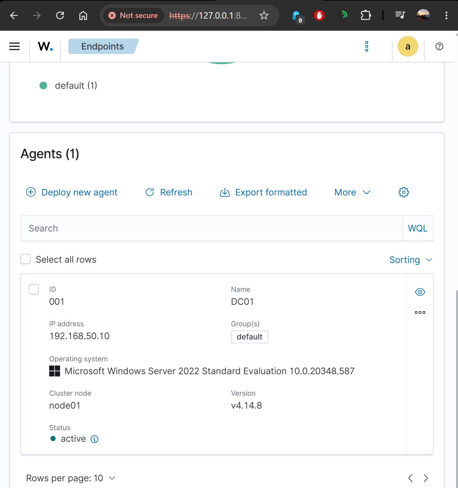

**Detection rules**
- Deployed 11 custom rules (`wazuh/iam_rules.xml`, IDs 100100 to 100122) covering account lifecycle, failed authentication and lockout, brute-force correlation, and group changes with escalation for privileged groups and out-of-hours changes. Validated with `wazuh-analysisd -t` before restarting the manager, so a syntax error could not take it down.

**Verification**
- Generated each event type with a throwaway account `test.alert` on DC01: creation, addition to and removal from Domain Admins, six bad passwords, an admin password reset and a disable. The account was deleted afterwards.

| Rule | Alert observed | Level |
|---|---|---|
| 100100 | User account created | 5 |
| 100102 | Password reset by another account (fired at creation, since setting an initial password is an admin reset, and again at the explicit reset) | 7 |
| 100122 | Privileged group change outside business hours (Domain Admins at 03:05) | 14 |
| 100104 | Kerberos bad password (x4) | 4 |
| 100110 | 5+ Kerberos bad passwords in 2 minutes (the fifth failure) | 10 |
| 100103 | Account locked out, caller computer DC01 | 8 |
| 100101 | Account disabled | 5 |

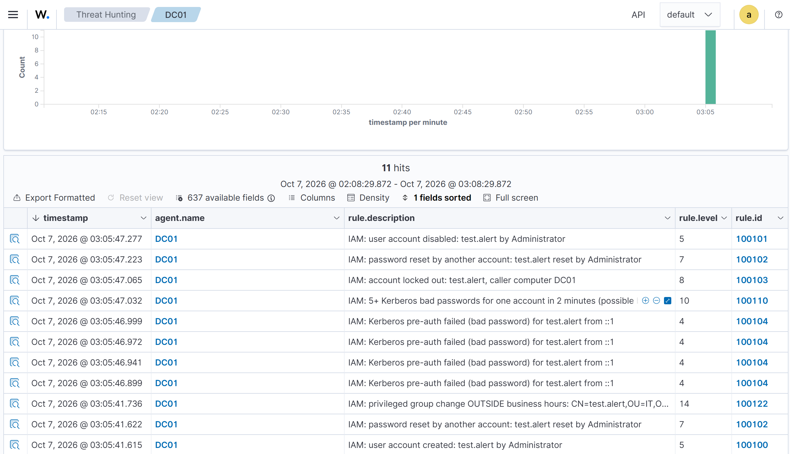

- Rules 100120 and 100121 did not appear as separate alerts: Wazuh reports the most specific rule in a matching chain, so the Domain Admins addition escalated 100120 > 100121 > 100122 and produced one level-14 alert. The fifth bad password likewise produced the correlation alert (100110) instead of a fifth 100104.

### Findings

**Finding 7: Detection coverage gaps identified during testing**
- Rule 100111 (NTLM bad passwords) was not exercised, because the test authentications used Kerberos. It is untested rather than known to work.
- Removal from a privileged group (event 4729) has no rule. An account added to and quickly removed from Domain Admins would only be partly visible. A follow-up rule for 4729/4733/4757 on privileged groups is the next improvement.
---

## Phase 4: Cloud identity with Okta

**Platform decision: Okta instead of Microsoft Entra ID**
- The original plan used Entra ID. Two constraints changed it:
  - Entra Connect Sync is not supported on a domain controller and needs a separate member server with 6 GB RAM; the lighter Entra Cloud Sync agent needs an Entra ID P1 licence.
  - No tenant with administrative rights was available without a paid Azure subscription (the only existing Azure access was inside a university directory, where the lab must not be built).
- Okta's Integrator Free Plan provides SSO, Universal Directory, adaptive MFA and lifecycle management for up to 10 users with no expiry, and its AD agent runs on a domain member server. The concepts (directory sync, delegated authentication, MFA, sign-on policy) carry over directly.

**AD agent and sync**
- Installed Okta AD Agent 3.23 on DC01, running as the `OktaService` domain account it created, activated through Okta's device code flow.
- Scoped the import to `OU=Users,OU=Lab` for users and `OU=Groups,OU=Lab` for groups, so admin accounts, service accounts, built-in accounts and disabled leavers never reach the cloud. Username format: UPN.
- Left Okta-to-AD provisioning (create users, sync passwords) disabled: AD is the source of truth and Okta only reads from it.

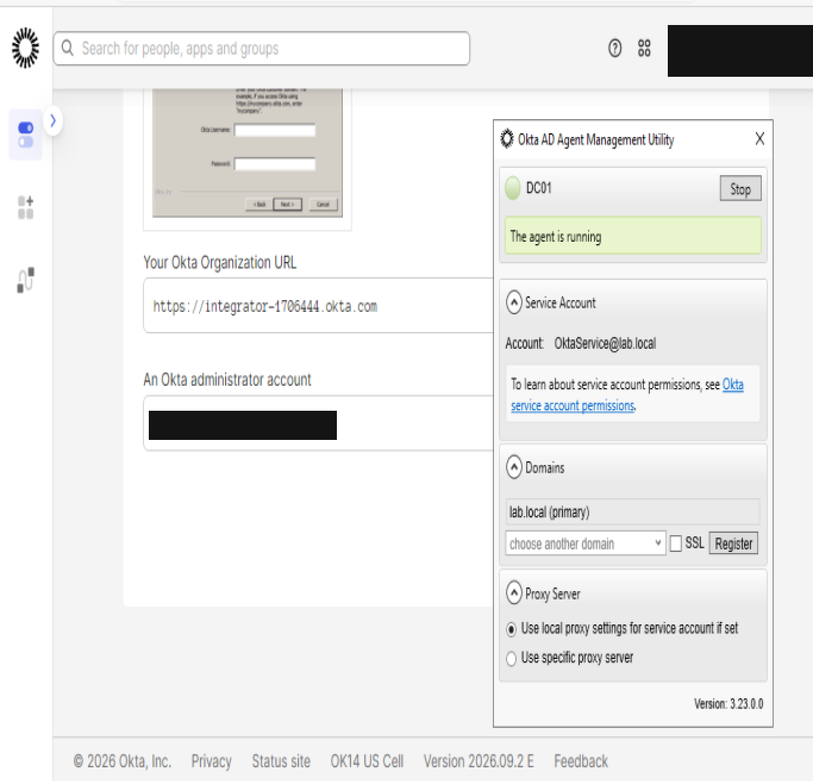

- First import found exactly 3 users (Aoife, Ciaran, Sean). Niamh and Roisin were not imported because the leaver process had moved them to Disabled Users, outside the scope.

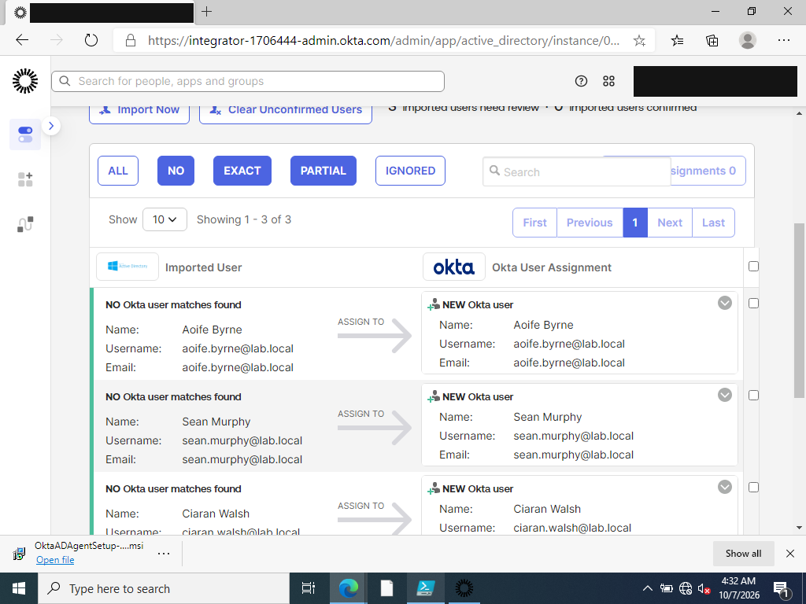

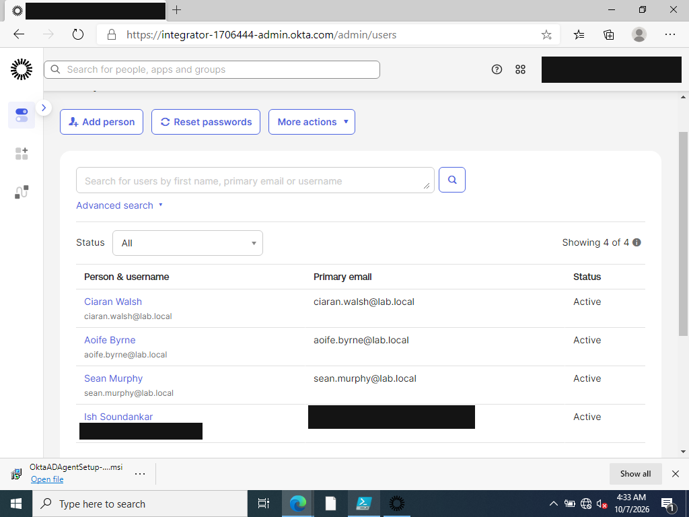

**Delegated authentication and MFA**
- Aoife signed in to Okta with her AD password: Okta checked it against DC01 through the agent, then required Okta Verify enrolment before granting access.

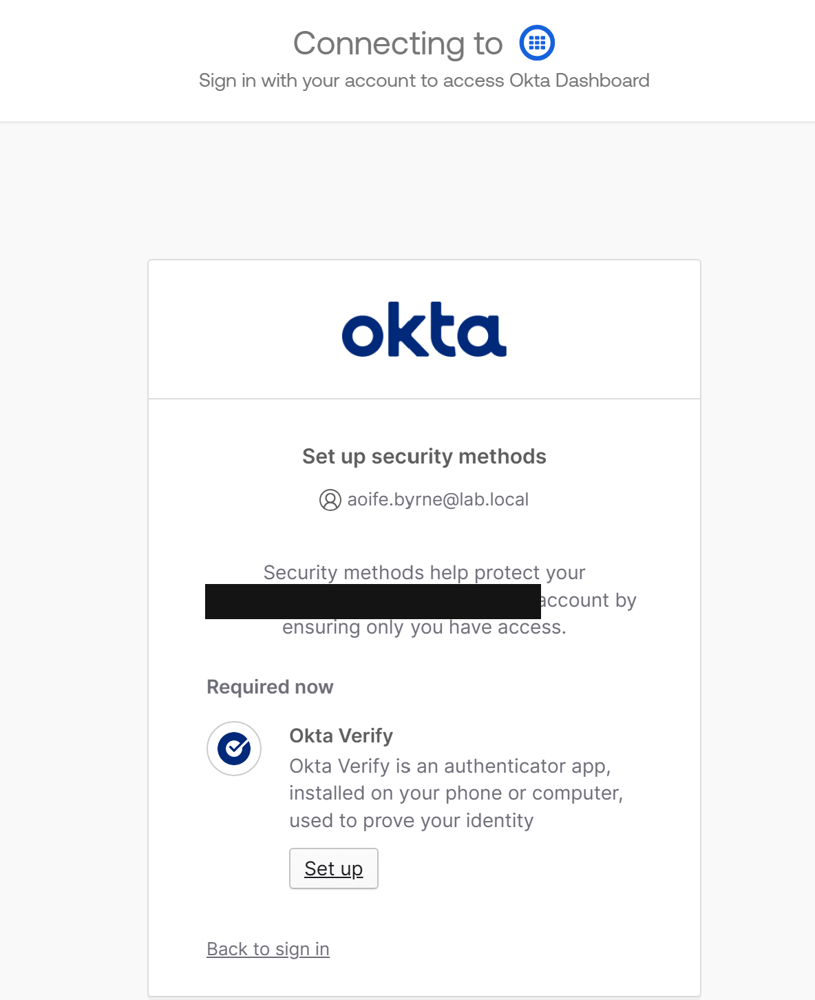

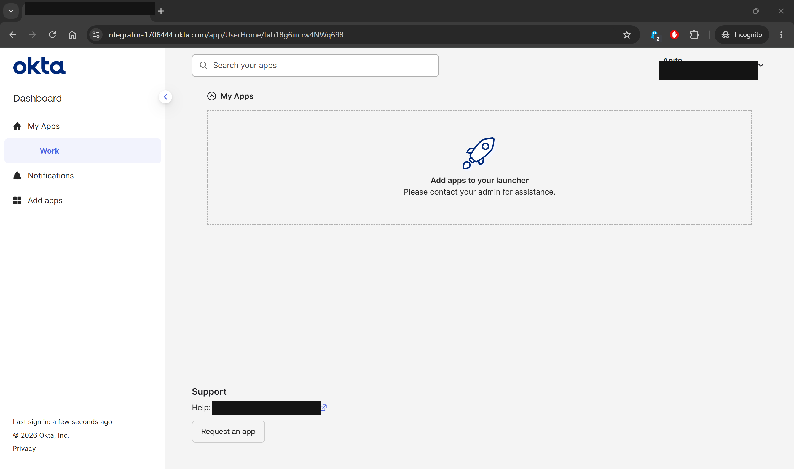

**Sign-on policy**
- Created network zone `Corporate-Office` and a Global Session Policy denying `GG_IT_ServiceDesk_Admins` sign-in from outside it. Tested and troubleshot in [TKT-005](../tickets/TKT-005-mfa-blocked-signin.md).

**Joiner to cloud, end to end**
- Liam Kavanagh was created through JML from one line of the HR change file and appeared in the next Okta import with no manual steps.

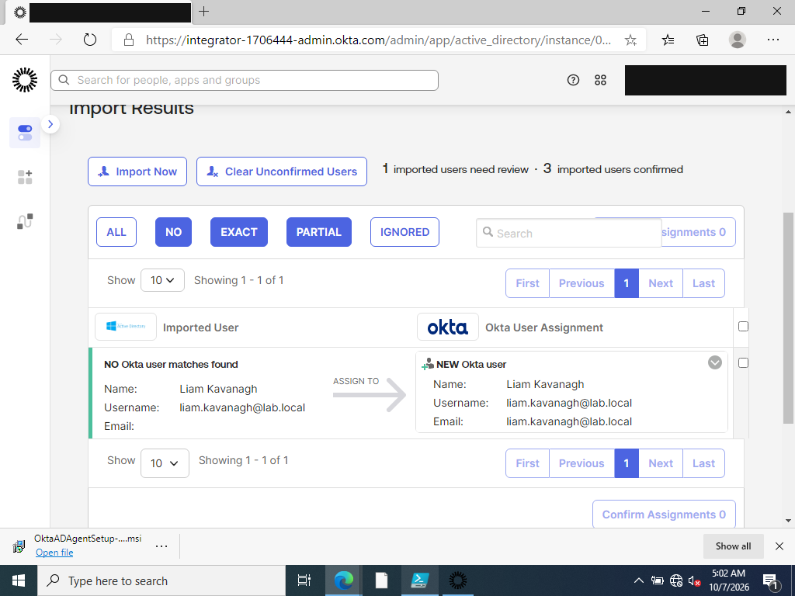

- Orla Nolan was created by hand and did not sync. Investigated and resolved in [TKT-004](../tickets/TKT-004-user-not-syncing.md).

### Findings

**Finding 8: Okta reported "invalid credentials" when the password was never checked**
- After the sign-on policy fix, Sean's sign-in failed with INVALID_CREDENTIALS. The detailed event two lines earlier showed the AD agent's delegated authentication request had timed out. Restarting the agent service resolved it. Full detail in TKT-005.

**Finding 9: Correction to an earlier assumption about email**
- Before the first import, every lab user was given an email equal to their UPN on the assumption that Okta would refuse users without one. Liam's later import (no email set) showed Okta falls back to the username instead, so that step was not required. The real issue is that `@lab.local` addresses cannot receive mail, so Okta's activation and reset emails would not be delivered.

**Finding 10: Sign-on policy blocks give users no reason, by design**
- The denied user sees a generic message. Diagnosis depends on the System Log's policy evaluation event, which names the exact policy and rule. Service desk procedures need to include reading it.

## All phases complete

| Phase | Status |
|---|---|
| 1. Domain and directory structure | Complete |
| 2. Joiner / Mover / Leaver | Complete |
| 3. Policy and privileged access | Complete |
| 4. Cloud identity (Okta) | Complete |
| 5. Monitoring (Wazuh) | Complete |
| 6. Access review and troubleshooting tickets | Complete (TKT-001 to TKT-006) |

## Possible extensions
- Wazuh rule for removals from privileged groups (4729/4733/4757) and a test of the NTLM correlation rule
- Windows LAPS for the local administrator account on WS01
- Assign a SAML or OIDC application in Okta to demonstrate SSO to a real app
- Add an "enabled users outside the Lab OU" check to the access review
