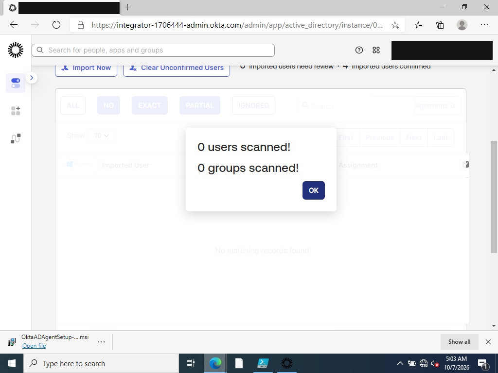
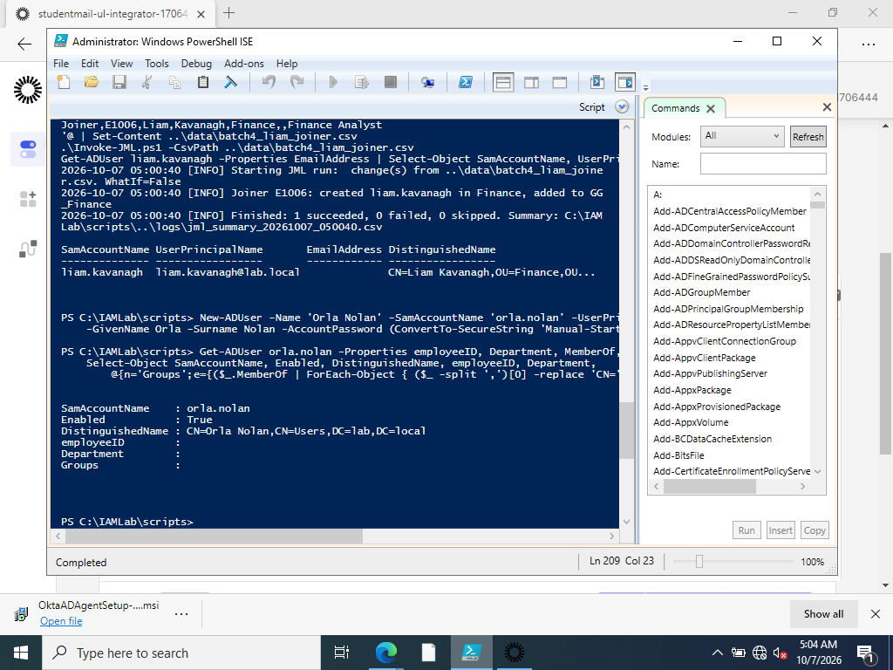

# TKT-004: New starter cannot sign in to Okta

| Field | Value |
|---|---|
| Reported by | Line manager for orla.nolan (HR) |
| Category | Sync / Lifecycle |
| Date | 2026-10-07 |
| Status | Resolved |
| Skills shown | Hybrid identity sync scope, directory hygiene, comparing process vs manual account creation |

## Scenario
Two new starters were created on the same day:
- **Liam Kavanagh** through the JML process (one line in the HR change file)
- **Orla Nolan** by hand, the way an administrator would by clicking New > User at the default location in AD Users and Computers

## Symptom
Liam appeared in Okta at the next import. Orla did not, so she cannot sign in to Okta at all. The incremental import reported **0 users scanned**.



## Investigation
```
SamAccountName    : orla.nolan
Enabled           : True
DistinguishedName : CN=Orla Nolan,CN=Users,DC=lab,DC=local
employeeID        :
Department        :
Groups            :
```



| Check | Liam (JML) | Orla (manual) |
|---|---|---|
| Location | `OU=Finance,OU=Users,OU=Lab` | `CN=Users` (built-in container) |
| In Okta sync scope (`OU=Users,OU=Lab`) | Yes | **No** |
| Employee ID, department, department group | Set | **Empty** |

## Root cause
The account was created outside the JML process, in AD's default `Users` container. The Okta AD integration only imports from `OU=Users,OU=Lab`, so Okta never saw her. The manual creation also skipped every other joiner step, so even once synced she would have had no department access.

## Resolution
Brought the account into line with what JML would have produced, then moved it into scope:
```powershell
Set-ADUser orla.nolan -EmployeeID 'E1007' -Department 'HR' -Title 'HR Assistant' -ChangePasswordAtLogon $true
Add-ADGroupMember GG_HR -Members orla.nolan
Move-ADObject (Get-ADUser orla.nolan).DistinguishedName -TargetPath 'OU=HR,OU=Users,OU=Lab,DC=lab,DC=local'
```
An incremental import in Okta then picked her up, and her assignment was confirmed.

## Prevention
- Create accounts only through the JML process, which always places users inside the synced OU with the correct attributes and groups.
- Redirect the default location for new user objects away from `CN=Users` (`redirusr` on the DC), so ad hoc creations land in a controlled OU instead of silently outside sync scope.
- A periodic check for enabled users outside `OU=Lab` would catch this; it could be added to `Get-AccessReview.ps1`.

## Related observation
Liam has no email attribute in AD (the JML script does not set one), yet Okta imported him using his UPN as his email. Okta falls back to the username, so a missing email does not block the import. However, the resulting address is `@lab.local`, which cannot receive mail, so Okta activation and reset emails would go nowhere. In production, UPN and email use a real, routable domain.
