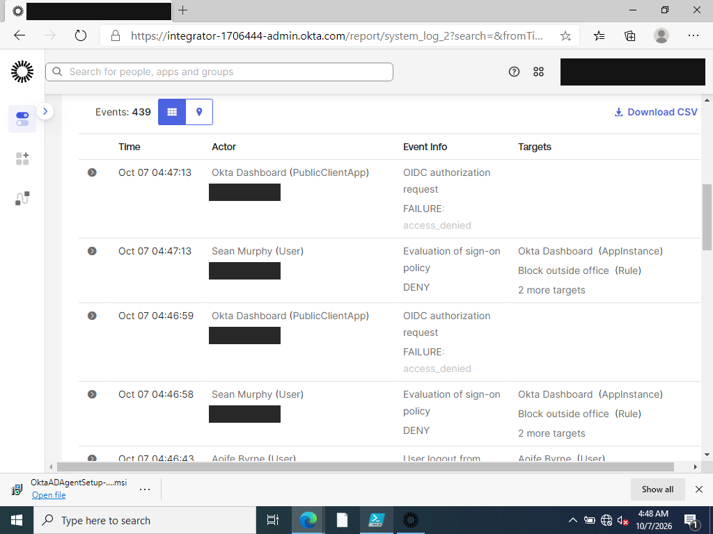
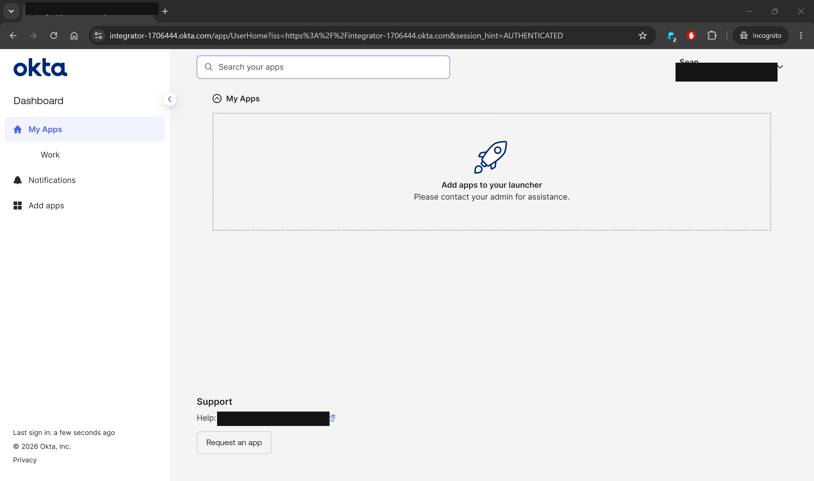

# TKT-005: Service desk analyst cannot sign in to Okta

| Field | Value |
|---|---|
| Reported by | sean.murphy (IT Service Desk) |
| Category | Sign-on policy / Authentication |
| Date | 2026-10-07 |
| Status | Resolved |
| Skills shown | Okta Global Session Policy, network zones, System Log analysis, delegated authentication troubleshooting |

## Scenario
Service desk accounts can reset passwords and unlock users (see Phase 3), so they are higher risk than standard users. A Global Session Policy was created for the AD-synced group `GG_IT_ServiceDesk_Admins`:

| Policy | Rule | Condition | Action |
|---|---|---|---|
| Service Desk - office only (priority 1) | Block outside office | User's IP **not in** network zone `Corporate-Office` | Access **Denied** |

`Corporate-Office` contained only a documentation-range address (`203.0.113.10`) representing the office.

## Symptom
Sean, working from home, signed in with his AD credentials and saw only:
> The resource owner or authorization server denied the request. If you're wondering why this is happening, please contact your administrator.

The message deliberately gives no reason, which protects the policy from being probed but means the service desk has to find the cause.

## Investigation, part 1: why was he denied?
Okta **Reports > System Log**, filtered on Sean:

| Event | Outcome | Target |
|---|---|---|
| Evaluation of sign-on policy | **DENY** | **Block outside office (Rule)** |
| OIDC authorization request | FAILURE: access_denied | Okta Dashboard |

Two attempts (04:46:58 and 04:47:13), both from his home IP, which is not in `Corporate-Office`.



**Root cause 1:** Sean is in a group that may only sign in from the office network, and he was connecting from home.

## Resolution, part 1
In production the question is whether the access is legitimate, not how to remove the rule: approved home working should go through the VPN or an approved location. For the lab, his home connection was treated as an approved location by adding its IP to `Corporate-Office`.

## Investigation, part 2: still failing after the policy fix
The next sign-in attempt failed again, this time with "Bad request". The System Log now showed:

| Event | Outcome |
|---|---|
| Evaluation of sign-on policy | **CHALLENGE** (Default Rule): the block no longer applied |
| **Authenticate user with AD agent** | **FAILURE: Delegated authentication request timed out. Ensure that the agent for your directory is connected to Okta** |
| User login to Okta | FAILURE: INVALID_CREDENTIALS |

The top-level event reports **invalid credentials**, but the detail two events earlier shows the password was never checked: Okta asks DC01 to verify it through the AD agent, and that request timed out.

Checks on DC01:
- Agent service `Okta Active Directory Service`: Running
- Internet: `ping 8.8.8.8` replied; `Resolve-DnsName` resolved the Okta org

**Root cause 2:** the AD agent was running but not answering delegated authentication requests in time, most likely because the host was under heavy load (DC01 plus the 8 GB Wazuh appliance on a virtualised laptop).

## Resolution, part 2
```powershell
Restart-Service 'Okta Active Directory Service'
```
A fresh sign-in then succeeded and Sean reached his dashboard.



## Lessons
- A denied sign-in shows the user nothing useful by design; the System Log's policy evaluation event names the exact rule responsible.
- **Do not trust the summary event.** "INVALID_CREDENTIALS" here was caused by the AD agent timing out, not a wrong password. Resetting Sean's password would have changed nothing.
- With delegated authentication, Okta sign-in for every AD user depends on the agent and the DC being available. Production deployments run several agents on separate servers for this reason.
- IP-based policies need a stable source address (fixed office IP or VPN). A home broadband IP can change and would re-trigger this ticket.
