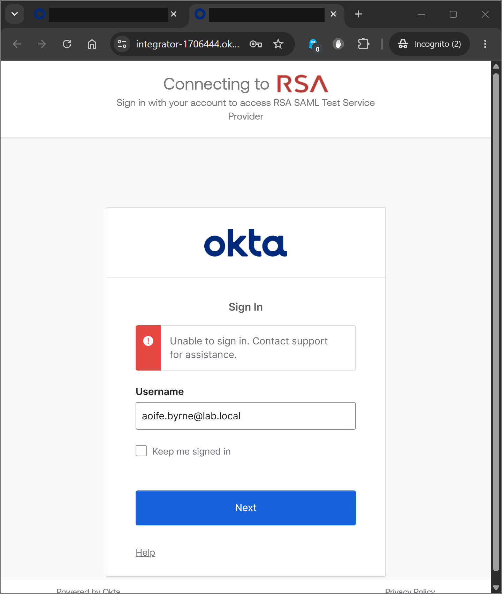
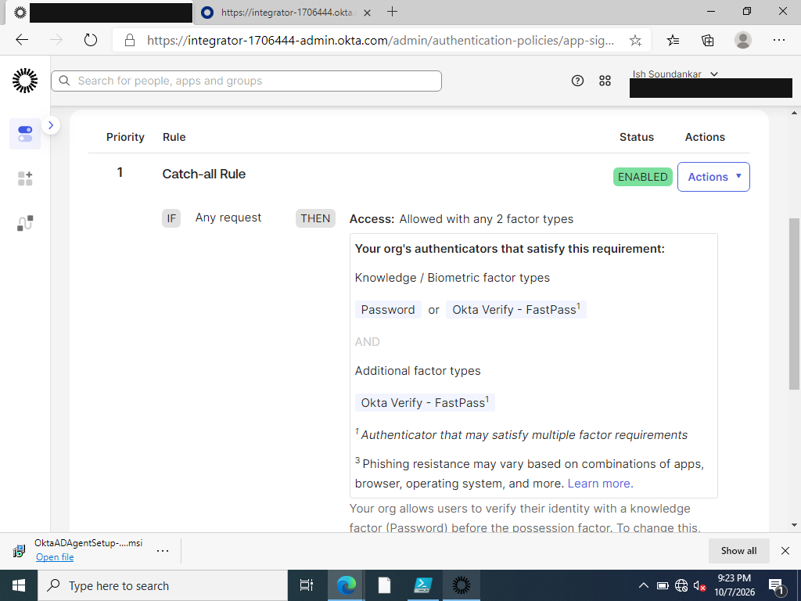
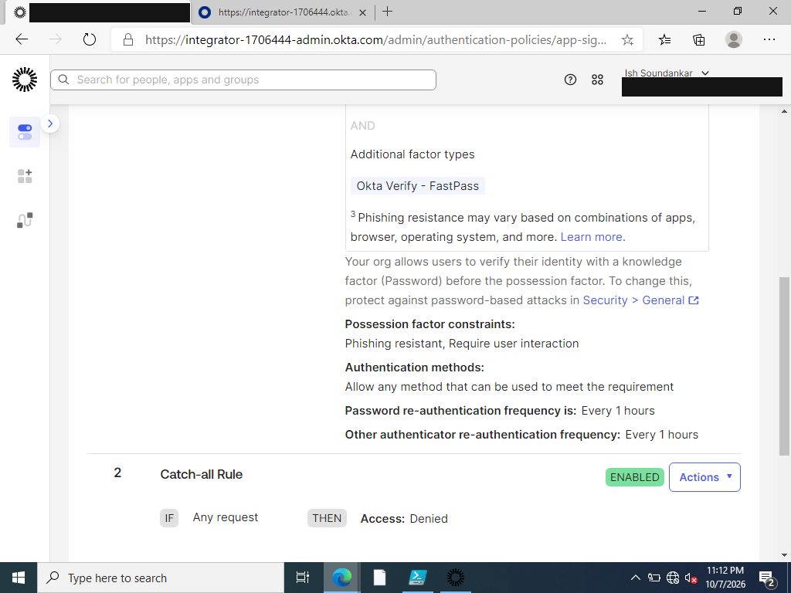
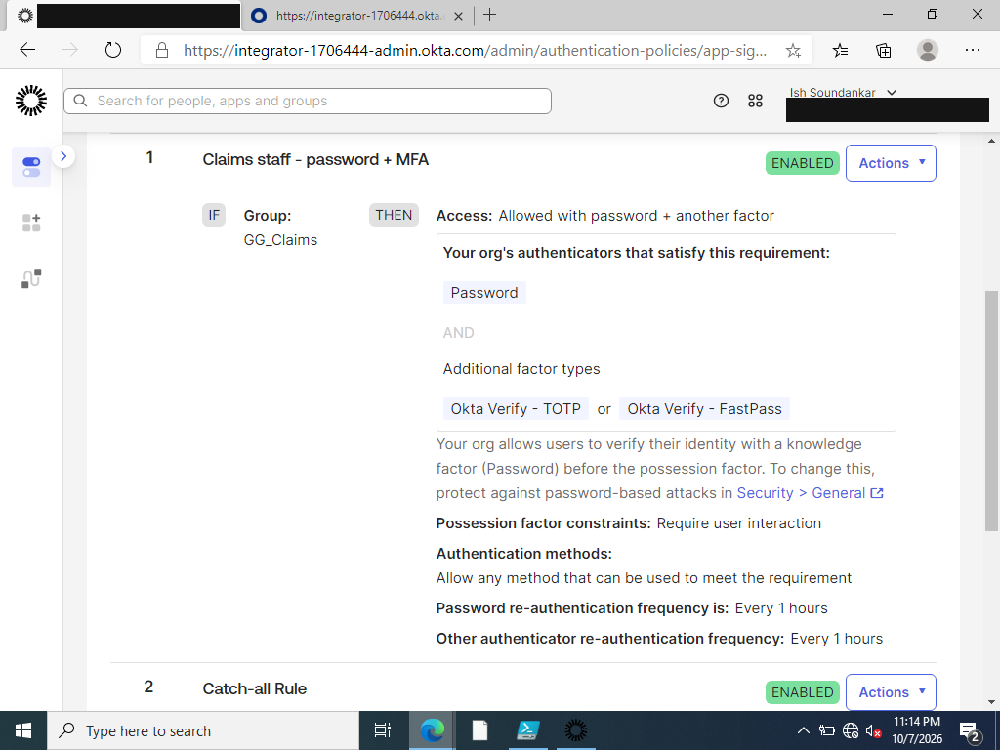
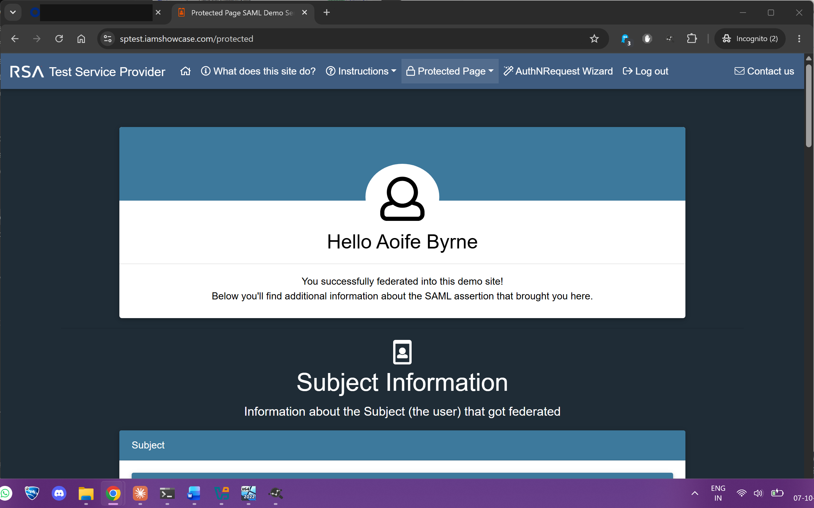
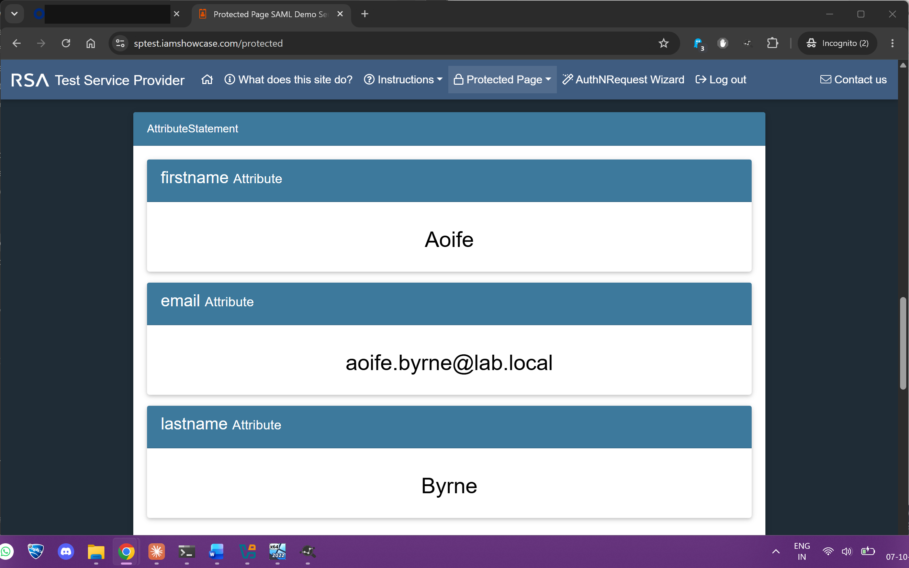
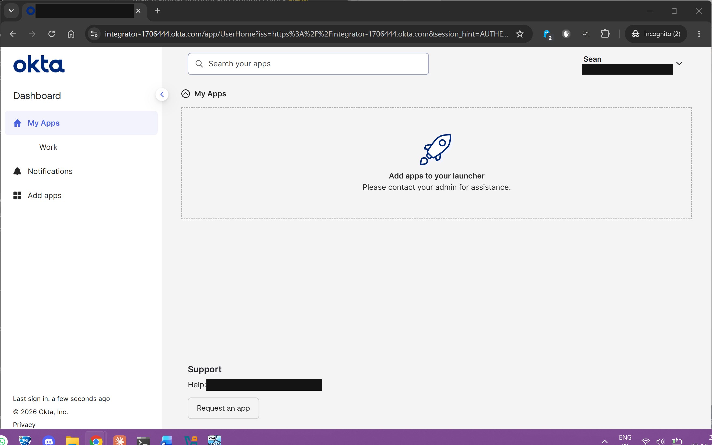
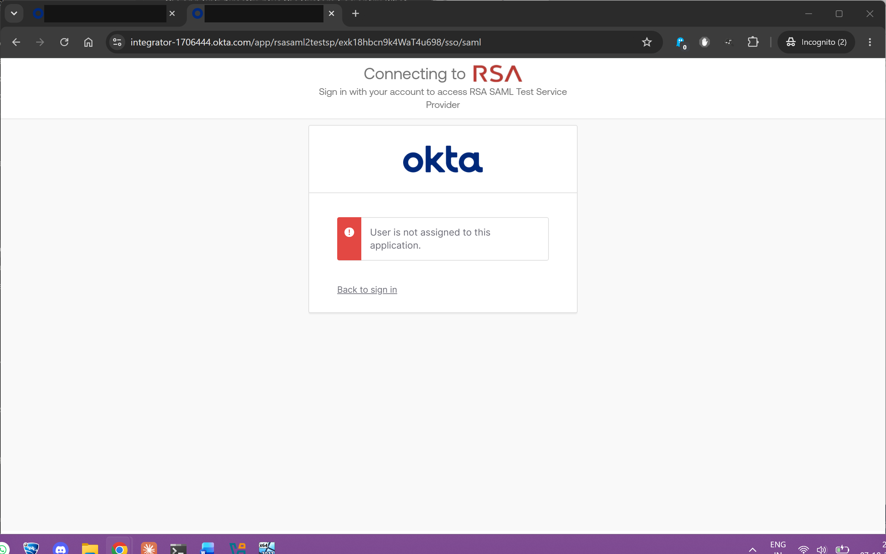
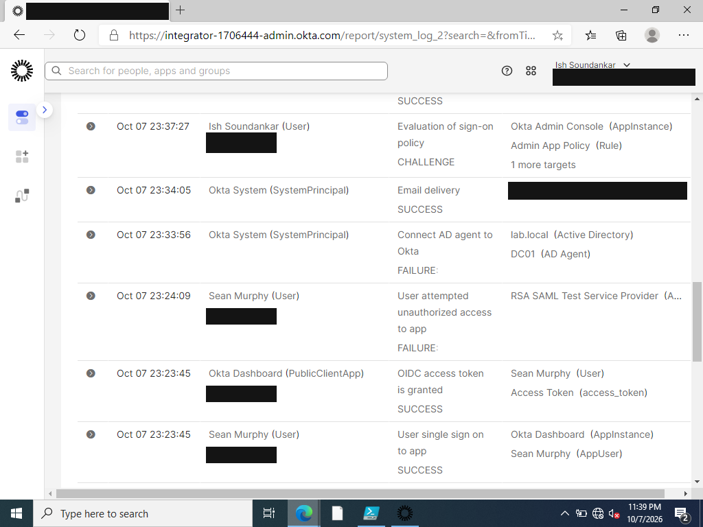

# TKT-007: Assigned user cannot open a SAML application

| Field | Value |
|---|---|
| Reported by | aoife.byrne (Claims) |
| Category | App sign-on policy / Authenticators |
| Date | 2026-10-07 |
| Status | Resolved |
| Skills shown | SAML 2.0 SSO, Okta app authentication policies, authenticator enrolment, System Log analysis |

## Scenario
A SAML 2.0 application (RSA SAML Test Service Provider) was added to Okta and assigned to the AD-synced group `GG_Claims`. Aoife, a Claims user, could see the app tile on her dashboard after the assignment.

## Symptom
Clicking the tile returned Aoife to an Okta sign-in page showing only:
> Unable to sign in. Contact support for assistance.

She had already signed in to the dashboard with her AD password and Okta Verify, so her credentials and MFA were known to work.

## Investigation
Okta **Reports > System Log**, filtered on Aoife. Each attempt produced the same pair of events:

| Event | Outcome | Target |
|---|---|---|
| Evaluation of sign-on policy | **DENY** | RSA SAML Test Service Provider, **Catch-all Rule** |
| App access | Access has been denied because the policy requirements could not be satisfied by the users' current set of available authenticator enrollments | RSA SAML Test Service Provider |

So the failure was not assignment, password or the AD agent: the **app's own authentication policy** required something Aoife had not enrolled.

The app's **Sign On** tab showed it had been given the default policy **Any two factors**. Its catch-all rule:

The only additional factor it accepted was **Okta Verify FastPass**, which needs Okta Verify registered on the device being used. Aoife was enrolled in Okta Verify on her phone (code), not FastPass on the PC, so the requirement could never be met.

**Root cause 1:** the app inherited a default authentication policy stricter than the one protecting the dashboard, so a user who could reach the dashboard could not open the app.

## Resolution, part 1
Instead of loosening the shared default policy, a dedicated app policy was created:

| Priority | Rule | Condition | Action |
|---|---|---|---|
| 1 | Claims staff - password + MFA | Group `GG_Claims` | Allowed: password + another factor |
| 2 | Catch-all Rule | Any request | **Denied** |

The app was then switched to this policy. The catch-all was set to Denied so anyone outside Claims is refused at the policy layer as well as by assignment.

## Investigation, part 2: the new rule still offered only FastPass
Reviewing the new rule before testing showed its possession factor constraints had defaulted to **Phishing resistant, Require user interaction**. Okta Verify codes and push are not phishing resistant, so FastPass was again the only factor listed.

**Root cause 2:** the phishing-resistant constraint silently excluded the factor the user was actually enrolled with.

## Resolution, part 2
Removed the **Phishing resistant** constraint (kept "Require user interaction"). The rule then accepted **Okta Verify TOTP** or FastPass.

Aoife signed in with her AD password and an Okta Verify code, and Okta sent a signed SAML assertion to the application:

The assertion carried `firstname`, `lastname` and `email` (`aoife.byrne@lab.local`, her AD UPN), showing the identity flowing AD > Okta > application.

## Negative test
Sean (IT Service Desk, not in `GG_Claims`):
- His dashboard showed no tile for the app.
- Opening the app's SSO URL directly returned **"User is not assigned to this application."**
- System Log: **User attempted unauthorized access to app: FAILURE**.

## Lessons
- Assignment decides who can **see** an app; the app's authentication policy decides who can **open** it. Both have to be right, and a new app does not inherit the dashboard's policy.
- "Unable to sign in" tells the user nothing. The System Log's policy evaluation event names the exact policy and rule.
- A phishing-resistant requirement is a sound target, but enforcing it before users have a phishing-resistant authenticator locks them out. Roll out FastPass or security keys first, then tighten the policy.
- Fix with a scoped rule for the group that needs access, not by weakening the shared default policy that other apps rely on.
